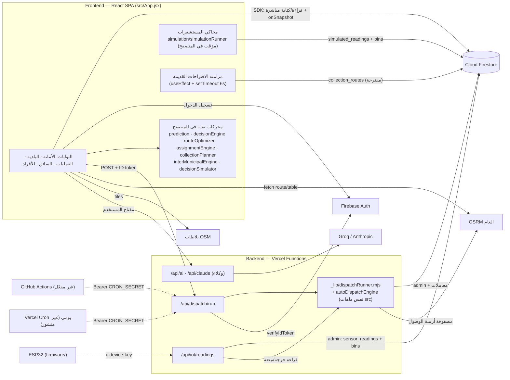

# المعمارية الفعلية — Smart Waste MIS
تاريخ التدقيق: 12 أكتوبر 2026 · المرجع: commit `0fc4f98` (محلي) · الفرع البعيد `origin/main` = `8ce8886`

> كل علاقة في المخطط مأخوذة من استدعاء فعلي في الكود (الملف مذكور). لا توجد علاقة مرسومة بلا مصدر.

## 1. التقنيات
| الطبقة | التقنية | الدليل |
|---|---|---|
| الواجهة | React 19 + Vite 8 (rolldown)، تطبيق صفحة واحدة | `package.json`، `src/main.jsx` |
| الخرائط | Leaflet 1.9 + react-leaflet 5، بلاطات OpenStreetMap | `src/App.jsx` (OperationalMap) |
| الرسوم | Recharts 3 | `src/App.jsx` |
| المصادقة | Firebase Auth (بريد وكلمة مرور) | `src/firebase.js`، `AuthProvider` في `src/App.jsx` |
| قاعدة البيانات | Cloud Firestore، يكتب العميل مباشرة عبر SDK، والحماية بالقواعد | `src/firestoreService.js`، `firestore.rules` |
| الخادم | دوال Vercel الخادمية (Node) + firebase-admin | `api/iot/readings.js`، `api/dispatch/run.js`، `api/_lib/*` |
| الجدولة | Vercel Cron (يومي) + GitHub Actions (كل 15 د) + عامل محلي | `vercel.json`، `.github/workflows/dispatch-schedule.yml`، `scripts/dispatchWorker.mjs` |
| المسارات | OSRM العام (`router.project-osrm.org`) للمسار والمصفوفة | `src/roadRouting.js`، `src/roadMatrix.js` |
| الذكاء الاصطناعي | Groq / Anthropic عبر وكيل يمرّر مفتاح المستخدم | `api/ai.js`، `api/claude.js`، `AIAssistant` |
| التصدير | xlsx 0.18.5 | `src/exportAllDataToExcel.js` |
| العتاد | برنامج ESP32 | `firmware/` |

## 2. حجم الكود وتقسيمه
- **ملف الواجهة:** `src/App.jsx` يحوي **10,141 سطرًا** ويضم كل الصفحات والبوابات والمكونات.
- **المحركات النقية:** 14 وحدة في `src/*.js` مثل decisionEngine وprediction وrouteOptimizer وassignmentEngine وautoDispatchEngine وcollectionPlanner وinterMunicipalEngine وdecisionSimulator وexecutionEngine وnavigation وsensorHealth وmapVisual وimpact وbinContext. هي مستقلة عن React وFirebase ومختبرة بـ vitest.
- **طبقة البيانات:** `src/firestoreService.js` (1,362 سطرًا) تضم الـ hooks وعمليات الكتابة.
- **حجم الحزمة:** ملف JS واحد بحجم **2,188.79 kB** (مضغوطًا 626.34 kB)، والبناء يحذر من الحجم (ARC-01).

## 3. المخطط المعماري (العلاقات الفعلية)

## 4. المكونات وحالتها
الوضع العام: كل ما بعد `8ce8886` موجود محليًا فقط.

| المكوّن | أين يعمل | الحالة الفعلية | الدليل |
|---|---|---|---|
| **Frontend** | المتصفح | يعمل محليًا (بناء ناجح، رحلات Playwright اليوم). الإنتاج على إصدار أقدم | `git status`: ahead 4 |
| **Backend** | Vercel | `api/iot/readings` و`api/dispatch/run` مختبران محليًا فقط (عبر وسيط Vite وبيئة معزولة). غير منشورين | `vite.config.js` (devServerFunctions) |
| **Database** | Firestore | القواعد في المستودع أحدث من المنشورة (آخر نشر 2026-10-11) | ملاحظة رأس `firestore.rules` |
| **Authentication** | Firebase Auth | يعمل. لا MFA، والحد الأدنى لكلمة المرور 6 أحرف | `src/App.jsx:453` |
| **IoT Simulation** | **المتصفح** (تبويب «قائد» بمؤقت) | يعمل محليًا. يعتمد على فتح صفحة المحاكاة وتشغيلها من حساب الأمانة | `SimulationPage` (`setInterval` + leader) |
| **Prediction Engine** | المتصفح والخادم | انحدار خطي حقيقي (PRED في DATA_MODEL/SYSTEM_AUDIT) | `src/prediction.js` |
| **Routing Engine** | المتصفح والخادم | NN + 2-opt + Or-opt على مصفوفة OSRM أو جوية | `src/routeOptimizer.js` |
| **Autonomous Dispatch** | الخادم | يعمل ومختبر تكامليًا محليًا. الجدولة الإنتاجية غير مفعّلة | `api/_lib/dispatchRunner.mjs` |
| **Decision Simulation** | المتصفح | نسخة معزولة (deep clone)، مختبر | `src/decisionSimulator.js` |
| **GIS** | المتصفح | حدود 14 حيًا من OSM (حي السلامة تقريبي)، ونطاقات البلديات هياكل محدبة توضيحية | `src/buraidahNeighborhoods.geo.json`، `operationalZones` |
| **External Services** | — | OSRM عام بلا اتفاقية خدمة، OSM tiles، Groq/Anthropic بمفتاح المستخدم | — |

## 5. واجهات API
| المسار | المصادقة | الحماية | الملاحظات |
|---|---|---|---|
| `POST /api/iot/readings` | مفتاح لكل جهاز يُقارن بـ SHA-256 وtimingSafeEqual | مفتاح إيقاف `IOT_INGEST_ENABLED`، حدود القيم، 5 ث بين قراءتين للجهاز | ينتظر دورة إسناد كاملة داخل الطلب (DSP-02) |
| `GET/POST /api/dispatch/run` | `CRON_SECRET` أو رمز Firebase + دور الموظف | المدير والموظف مقيّدان ببلديتهما، ومفتاح إيقاف | لا حد لمعدل الطلبات (SEC-07) |
| `POST /api/ai` | يمرّر ترويسة Authorization للمستخدم | لا شيء | وكيل مفتوح (SEC-11) |
| `POST /api/claude` | يمرّر `x-api-key` للمستخدم | لا شيء | وكيل مفتوح (SEC-11) |

## 6. الجدولة الفعلية
| الآلية | الملف | الحالة |
|---|---|---|
| قراءة IoT حرجة تشغّل دورة فورية | `api/iot/readings.js:118` | كود موجود، غير منشور، ولا جهاز حقيقي مسجّل في الإنتاج (غير محقق) |
| نبضة كل قراءة (تحترم الفاصل) | `api/iot/readings.js:119` | كود موجود، غير منشور |
| Vercel Cron يومي | `vercel.json` | غير منشور، ويحتاج `CRON_SECRET` في Vercel |
| GitHub Actions كل 15 د | `.github/workflows/dispatch-schedule.yml` | **غير مفعّل:** لم يُدفع إلى GitHub، والأسرار غير مضبوطة، فيتخطى نفسه |
| عامل محلي | `scripts/dispatchWorker.mjs` | يعمل محليًا (جُرّب: تشغيل ثم «not_due») |
| حدث المحاكي | `requestDispatchCycle` | يعمل محليًا |
| مزامنة المتصفح القديمة | `useEffect` + `setTimeout(6000)` في الغلاف | تعمل فقط حين يكون الإسناد «متوقفًا»، وتكتب من متصفح الموظف |
