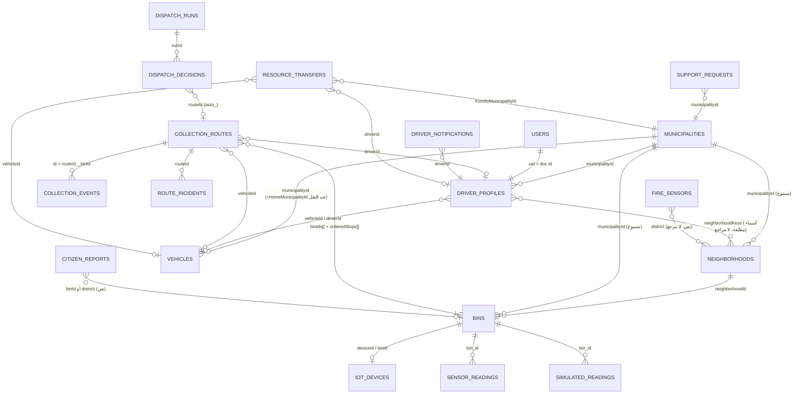

# نموذج البيانات — Firestore
المصدر: `src/firestoreService.js` (ثوابت `COLLECTIONS`)، `firestore.rules`، `api/_lib/dispatchRunner.mjs`، `src/simulation/simulationRunner.js`، `src/seedFirestore.js`.
لم تُقرأ بيانات الإنتاج. التحليل منطقي من الكود فقط.

## 1. المجموعات واستخدامها
عدد المراجع = مرات ظهور `COLLECTIONS.X` في الخدمة والواجهة.

| المجموعة | المراجع | الكاتب | الحالة |
|---|---|---|---|
| `municipalities` | 2 | الأمانة (seed) | فعّالة |
| `neighborhoods` | 7 | الموظفون والأمانة | فعّالة، توجد مستندات مكررة بالاسم (DATA-04) |
| `bins` | 12 | العميل والخادم والمحاكي | فعّالة |
| `iot_devices` | 3 | الموظفون | فعّالة، القواعد واسعة (SEC-06) |
| `sensor_readings` | 3 | الخادم فقط | فعّالة، بلا احتفاظ زمني (DATA-01) |
| `simulated_readings` | 4 | العميل (المحاكي) | فعّالة، بلا احتفاظ زمني (DATA-01) |
| `simulation_state`, `demo_sessions` | — | العميل | بيئة العرض |
| `collection_routes` | 21 | العميل والخادم والسائق | محورية |
| `collection_events` | 3 | السائق | فعّالة |
| `vehicles`, `driver_profiles`, `driver_vehicle_assignments` | 11 / 13 / 4 | الموظفون والسائق | فعّالة |
| `driver_shifts` | 2 | السائق (تسجيل حضور) | سجل فقط، لا جداول مناوبات (RTE-03) |
| `driver_assignment_history` | 3 | الموظفون | بلا واجهة قراءة |
| `driver_locations` | 2 | السائق | فعّالة، بلا احتفاظ زمني |
| `route_incidents` | 5 | السائق والموظفون | فعّالة |
| `vehicle_status_history` | 2 | أي عضو طاقم | فعّالة |
| `driver_notifications` | 3 | الخادم فقط | فعّالة |
| `dispatch_settings`, `dispatch_decisions`, `dispatch_runs`, `dispatch_locks` | 3 / 3 / 2 / — | الخادم والأمانة | فعّالة محليًا |
| `support_requests`, `resource_transfers` | 5 / 6 | البلدية والأمانة | فعّالة |
| `optimization_runs`, `simulation_scenarios` | 3 / 3 | العميل | سجلات |
| `decision_recommendations` | 2 | **لا كاتب في الواجهة** | ميتة (DATA-05) |
| `audit_log` | 14 | العميل والخادم | قابل للتزوير (SEC-05) |
| `alerts`, `fire_alerts`, `fire_sensors` | 7 / 3 / — | الموظفون والـ seed | `fire_sensors` بيانات ثابتة مزروعة (IOT-03) |
| `requests`, `citizen_reports` | 5 / 6 | المواطن والموظفون | فعّالة |
| `analytics/*` | — | seed | مرجعية أو عشوائية الاحتياط (DATA-07) |
| `users` | 4 | المستخدم والإدارة | تصعيد صلاحيات (SEC-01) |
| **قديمة:** `stations`, `suctionJobs`, `containers`, `districts`, `sensors`, `reports` | `stations` 3 | seed | `stations` ما زالت تغذي بوابة الأفراد والتنبيهات الحرارية والتنبؤ الموسمي والمساعد الذكي (DATA-02) |
| `route_bins` | 0 | — | معلنة في القواعد وغير مستخدمة |

## 2. مخطط ERD منطقي (العلاقات كما يستخدمها الكود)

## 3. الحالات والمسميات
| الكيان | القيم المستخدمة | ملاحظة |
|---|---|---|
| الجولة | suggested, approved, in_progress, completed, rejected, deferred, withdrawn | لا حالة «ملغاة بعد البدء» ولا «معلّقة» |
| قرار الإسناد | observed, executed, open, resolved, dismissed, rejected_at_commit, superseded | — |
| النقل | proposed, approved, executed, returned, rejected | — |
| طلب الدعم | open, approved, rejected, withdrawn | — |
| المركبة | available, on_route, maintenance, offline | — |
| المستخدم | pending, active، و**approved** يقبلها `api/dispatch/run.js` فقط | القواعد تعتمد `active` وحدها (SEC-12) |
| بلاغ المواطن | نصوص عربية («تم الحل»، «مرفوض»، «مغلق») | المقارنة بنصوص عربية حرفية في `src/binContext.js` (DATA-03) |
| اتصال المستشعر | online, offline, fault, no_sensor (محسوبة لا مخزّنة) | المحاكي يخزّن `sensorConnectivity` أيضًا، فهناك مصدران (IOT-01) |

## 4. المشكلات
- **DATA-01 (P1) قراءات بلا حدود.**
  - **الدليل:** `useRecentReadings` (`src/firestoreService.js:271-295`) يشترك في `collection(db, SIMULATED_READINGS)` و`collection(db, SENSOR_READINGS)` كاملتين، ثم يرشّح بالوقت على العميل. لا آلية احتفاظ أو حذف.
  - **الأثر:** كل مستخدم من الطاقم ينزّل كامل التاريخ عند فتح المنصة، فتتضخم الكلفة والزمن مع كل يوم تشغيل.
  - **الإصلاح:** استعلام `where("timestamp", ">=", cutoff)` مقيّد بالبلدية، و TTL أو أرشفة.
  - **التحقق:** قياس عدد المستندات المقروءة عند الدخول قبل الإصلاح وبعده.
- **DATA-02 (P1) النموذج القديم ما زال يغذي واجهات حية.**
  - **الدليل:** `CitizenPortal` (`myStation = stations.find(...)`)، و`FireAlertPage → generateFireData(stations)`، و`AIAssistant({ stations, suctionJobs })`، وتبويبات التنبؤ الموسمي، وتقارير الأمانة.
  - **الأثر:** بوابة الأفراد والمساعد الذكي يعرضان بيانات «محطات» لا علاقة لها بالحاويات الذكية.
  - **الإصلاح:** ترحيل هذه الواجهات إلى `bins` و`neighborhoods`، ثم أرشفة المجموعات القديمة.
  - **التحقق:** `grep stations src/App.jsx` يعطي 0 خارج الترحيل.
- **DATA-03 (P2) حالات بنصوص عربية حرفية.**
  - **الدليل:** `src/binContext.js` يقارن `r.status !== "تم الحل"`.
  - **الأثر:** أي تغيير في صياغة الحالة يكسر حساب البلاغات المفتوحة بصمت.
  - **الإصلاح:** رموز حالة إنجليزية ثابتة مع جدول تسميات.
  - **التحقق:** اختبار وحدة للبلاغات المفتوحة.
- **DATA-04 (P2) الحي يُعرَّف بالاسم لا بالمعرّف في عدة مسارات.**
  - **الدليل:** `neighborhoodKeys` للسائقين أسماء مطبّعة. `fire_sensors.district` و`citizen_reports.district` نصوص. وجود `groupNeighborhoodsByName` (11 استدعاء) لدمج مستندات أحياء مكررة.
  - **الأثر:** تغيير اسم حي يُسقط تغطية السائقين والتنبيهات الحرارية، والتكرار يضاعف العدّ.
  - **الإصلاح:** مراجع بالمعرّف، وإزالة التكرار بترحيل.
  - **التحقق:** اختبار تغطية بعد إعادة تسمية حي.
- **DATA-05 (P3) مجموعات ميتة أو بلا واجهة.**
  - **الدليل:** `route_bins` (0 مراجع)، `sensors` (seed فقط)، `decision_recommendations` (الدالة `saveDecisionRecommendation` بلا مستدعٍ في الواجهة)، `driver_assignment_history` بلا قراءة.
  - **الأثر:** تشويش وقواعد زائدة.
  - **الإصلاح:** حذف أو ربط، بقرار.
  - **التحقق:** القواعد والخدمة بلا مراجع ميتة.
- **DATA-06 (P3) الفهارس غير مُدارة في المستودع.**
  - **الدليل:** `firebase.json` بلا `indexes`، ولا يوجد ملف `firestore.indexes.json`.
  - **الأثر:** استعلامات مركبة جديدة قد تفشل في الإنتاج. لم تُرصد استعلامات تحتاج فهرسًا مركبًا (مساواة و`in` فقط)، لكن الإنتاج **غير محقق**.
  - **الإصلاح:** إضافة ملف الفهارس.
  - **التحقق:** `firebase deploy --only firestore:indexes` على بيئة اختبار.
- **DATA-07 (P2) بيانات تحليلية عشوائية أو مزروعة.**
  - **الدليل:** `generateMonthlyTrend` و`generateWeeklyData` وغيرها، 38 استخدامًا لـ `Math.random()` في `src/App.jsx`، تُستخدم احتياطًا عند غياب مستندات `analytics`.
  - **الأثر:** أرقام تتغير مع كل تحميل. موسومة «توضيحي» في التبويبات المعنية، لكنها تبقى بلا مصدر.
  - **الإصلاح:** إزالة الاحتياط العشوائي وعرض «لا بيانات».
  - **التحقق:** صفر `Math.random` في مسارات البيانات المعروضة.
- **DATA-08 (P3) نسخ `municipalityId` يتم من المتصفح بدفعة واحدة.**
  - **الدليل:** `setNeighborhoodMunicipality` (`src/firestoreService.js`) يحدّث الحي وكل حاوياته وجولاته في `writeBatch` واحد من المتصفح. حد Firestore 500 عملية للدفعة، فحي يتجاوز نحو 495 حاوية وجولة يفشل كاملًا. ولا يحدّث تغطية السائقين `neighborhoodKeys`. لا يوجد اختبار لهذه الدالة.
  - **الأثر:** منخفض بالحجم الحالي (120 حاوية)، ويظهر عند التوسع.
  - **الإصلاح:** تنفيذ خادمي مقسّم إلى دفعات مع اختبار.
  - **التحقق:** اختبار تكامل بحي يضم 600 حاوية.

## 5. التزامن وفقدان البيانات
- **محمي:**
  - الإسناد التلقائي بمعاملات وقفل لكل بلدية ومفاتيح Idempotency (مختبر بتشغيلين متزامنين).
  - تأكيد التفريغ بمعرّف حتمي `routeId__binId`.
  - طابور السائق دون اتصال (`offlineQueue`، مختبر وحدويًا).
- **غير محمي:**
  - مزامنة المتصفح القديمة تكتب من عدة متصفحات معًا مع حارس محلي فقط (`syncingRef`)، وقد تتسابق بين موظفين حين يكون الإسناد متوقفًا.
  - الاعتماد اليدوي (`approveAndAssignRoute`) تحديث مباشر بلا معاملة. يُفحص التعارض في الواجهة فقط، فقد يتعارض مع إسناد تلقائي متزامن.
- **فقدان البيانات:** لا حذف للسجلات التشغيلية (القواعد تمنعه). الخطر الفعلي هو التضخم بلا احتفاظ (DATA-01)، لا الفقدان.
