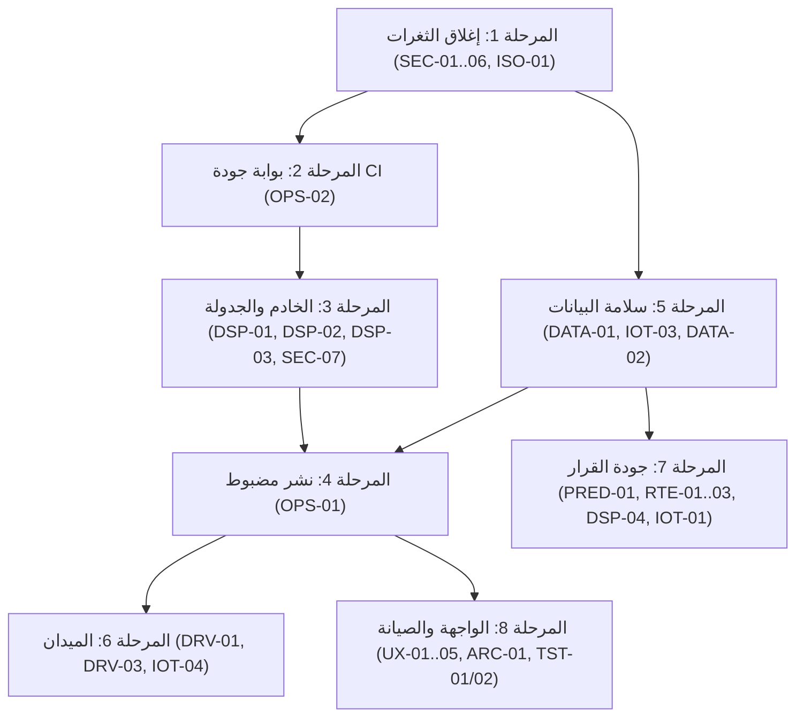

# خطة التطوير المقترحة (مرتبة بالأولوية والاعتماديات)
لم يُنفَّذ أي بند. كل مرحلة تنتهي بمعيار قبول قابل للتحقق. المعرّفات تشير إلى SYSTEM_AUDIT.md.

## المرحلة 1 — إغلاق الثغرات (مانع؛ قبل أي عرض عام)
| المهمة | المعرّف | الاعتماد | معيار القبول |
|---|---|---|---|
| منع تغيير `role` و`status` و`municipalityId` إلا للأمانة، ومنع التعديل الذاتي | SEC-01 | — | فحص SEC-01 وSEC-01b مرفوض |
| تقييد قراءة `users` بالبلدية، وفصل الحقول الحساسة | SEC-02 | — | فحص SEC-02 مرفوض |
| رفض أدوار الطاقم بلا بلدية، وإلزامها عند الاعتماد، وقصر التسجيل الذاتي على الأفراد | SEC-03 | — | فحص SEC-03 مرفوض |
| `sameMun` لكل المجموعات التشغيلية، والبيانات المرجعية للأمانة | SEC-04 | — | فحوص لكل مجموعة |
| `actorId == auth.uid` في السجل، وحظر `system:*` من العميل | SEC-05 | — | فحص SEC-06 مرفوض |
| فصل تجزئة مفاتيح الأجهزة وتقييد الكتابة | SEC-06 | — | فحص SEC-05 وSEC-05b مرفوض |
| `municipalityId` للبلاغات والطلبات وتقييد الصفحة | ISO-01 | SEC-04 | موظف لا يرى بلاغات غيره |
| نقل سكربت الفحص إلى `tests/rules` | — | ما سبق | 11 اختبارًا جديدًا ناجحًا |

## المرحلة 2 — بوابة جودة
| المهمة | المعرّف | الاعتماد | معيار القبول |
|---|---|---|---|
| workflow للاختبارات والقواعد والتكامل وE2E والبناء على كل دفع وطلب دمج | OPS-02 | 1 | فشل متعمد يمنع الدمج |
| حماية فرع `main` (مراجعة + نجاح CI) | OPS-02 | — | دفع مباشر مرفوض |

## المرحلة 3 — الخادم والجدولة
| المهمة | المعرّف | الاعتماد | معيار القبول |
|---|---|---|---|
| فصل دورة الإسناد عن رد `api/iot/readings` (طلب لاحق أو طابور)، وضبط `maxDuration` | DSP-02 | 2 | زمن رد ingest أقل من ثانية |
| حد معدل للتشغيل اليدوي | SEC-07 | — | الطلب الثاني يرد 429 |
| قرار مزود المسارات (OSRM خاص أو تجاري) مع احتياط | DSP-03 | — | اختبار حمل |
| توثيق `CRON_SECRET` و`DISPATCH_API_ENABLED` و`DISPATCH_URL` في `.env.example` | DSP-01 | — | مراجعة |

## المرحلة 4 — نشر مضبوط (بموافقة صاحب المشروع)
| المهمة | المعرّف | الاعتماد | معيار القبول |
|---|---|---|---|
| نشر القواعد على مشروع Firebase تجريبي، ثم الإنتاج | OPS-01 | 1، 2 | اختبارات القواعد على البيئة المنشورة |
| ضبط الأسرار في Vercel وGitHub، والدفع، وتشغيل workflow يدويًا | DSP-01 | 3 | وثيقة `dispatch_runs` جديدة كل 15 دقيقة |
| فحص دخاني بسيناريو DEMO_READINESS على الإنتاج | — | ما سبق | 15 خطوة: PASS أو PARTIAL موثق |

## المرحلة 5 — سلامة البيانات
| المهمة | المعرّف | الاعتماد | معيار القبول |
|---|---|---|---|
| استعلام القراءات بزمن وبلدية + TTL أو أرشفة | DATA-01 | 1 | قراءات الدخول ثابتة مع نمو البيانات |
| اشتقاق الخطر الحراري من حرارة الحاويات، وإزالة أو وسم `fire_sensors` و`generateFireData` | IOT-03 | — | لا عشوائية في التنبيهات الحرارية |
| ترحيل بوابة الأفراد والمساعد عن `stations` | DATA-02 | — | `grep stations` بلا نتائج في المسارات الحية |
| رموز حالات ثابتة، ومراجع الأحياء بالمعرّف | DATA-03، DATA-04 | — | اختبارات |
| إزالة `Math.random` من البيانات المعروضة | DATA-07 | — | صفر |

## المرحلة 6 — الميدان
| المهمة | المعرّف | الاعتماد | معيار القبول |
|---|---|---|---|
| Web Push (FCM) لإشعارات السائق | DRV-01 | 4 | إشعار يصل والتطبيق مغلق |
| ربط تأكيد التفريغ بقراءة محاكاة خادميًا في بيئة العرض | DRV-03 | 4 | لوحة البلدية تتحدث دون تبويب المحاكي |
| تشغيل المحاكي خادميًا (عامل) | IOT-04 | 4 | نبضات مستمرة دون متصفح |
| سياسة مسافة لتأكيد التفريغ (تحذير أو تبرير) | DRV-02 | — | اختبار |

## المرحلة 7 — جودة القرار
| المهمة | المعرّف | معيار القبول |
|---|---|---|
| ثقة التنبؤ بجودة الملاءمة، والحساب من وقت آخر قراءة | PRED-01 | اختبارات |
| مصفوفة OSRM لترتيب توقفات الإسناد | RTE-01 | `matrixSource = osrm` في الجولات التلقائية |
| حالات مستشعر متعددة الأبعاد (LOW_BATTERY، STALE، RECOVERED) | IOT-01 | اختبارات |
| نوافذ المناوبات وجولات متتابعة للسائق | RTE-03، DSP-04 | تصعيدات أقل في البلديات قليلة السائقين |
| VRP بالسعة ومواقع تفريغ موثقة | RTE-02 | مقارنة بالحل الحالي |

## المرحلة 8 — الواجهة والصيانة
| المهمة | المعرّف |
|---|---|
| تصحيح التباين (AA) | UX-01 |
| جداول قابلة للفلترة للحاويات وسجل العمليات | UX-02 |
| عزل التوضيحي في «بيئة العرض» | UX-04 |
| صفحة دخول بالسمة الفاتحة (بعد رفع التأجيل) | UX-05 |
| تقسيم `App.jsx` وتحميل كسول | ARC-01 |
| اختبارات واجهة آلية (Playwright في المستودع) | TST-01 |
| اختبارات تكامل: ingest، النقل، الدعم، تبعية الأحياء | TST-02 |
